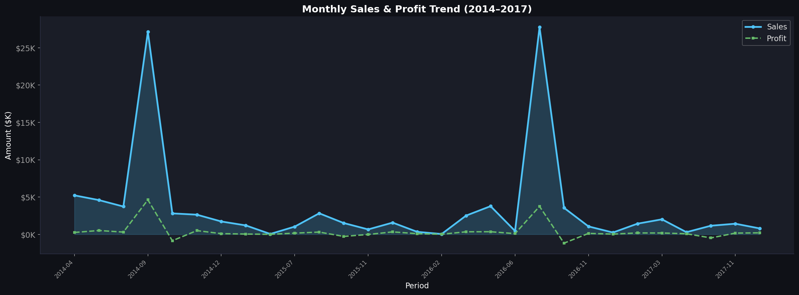
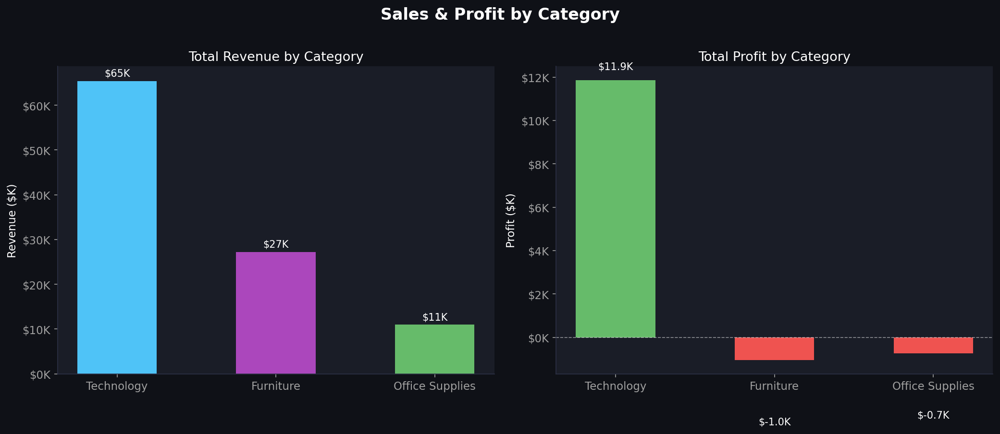
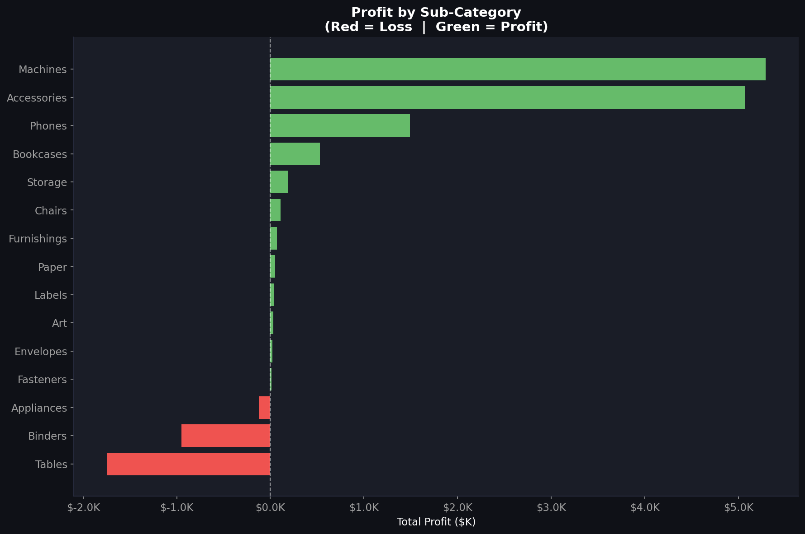
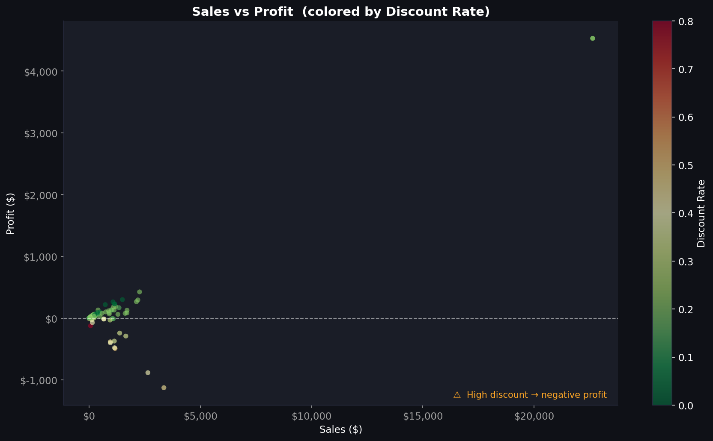
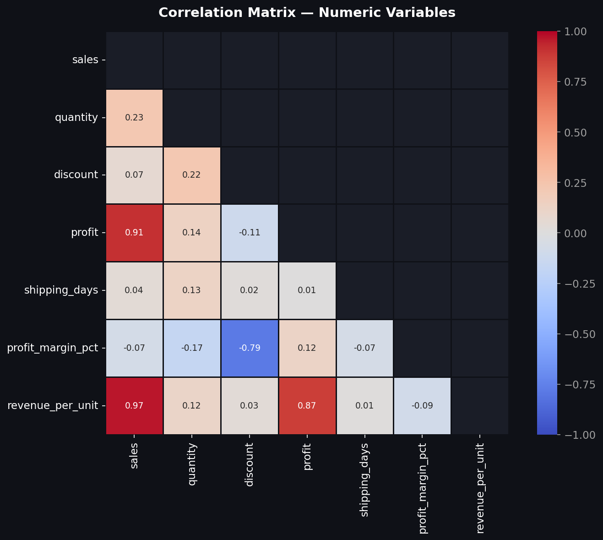
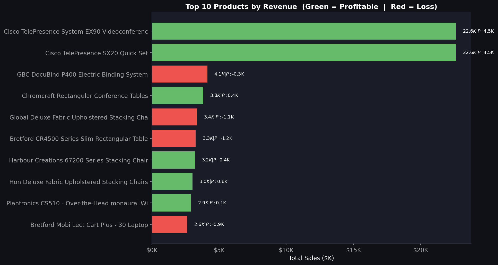

<div align="center">

# 📊 RetailIQ – Retail Sales Analytics Dashboard

### An End-to-End Retail Sales Analytics Portfolio Project

[](https://python.org)
[](https://pandas.pydata.org)
[](https://numpy.org)
[](https://matplotlib.org)
[](https://seaborn.pydata.org)
[](https://mysql.com)
[](https://jupyter.org)
[](https://powerbi.microsoft.com)
[](LICENSE)

[](https://github.com/priyanshugoswami9027)
[](https://www.linkedin.com/in/priyanshugoswami01/)
[](https://priyanshugoswami9027.github.io/)
[](mailto:priyanshugoswami089@gmail.com)

<br/>

**Demonstrating the complete Data Analytics workflow — from raw data to executive insights.**

**Built using Python, SQL, Jupyter Notebook, and Power BI to analyze retail sales data and generate actionable business insights.**

</div>

---

## 📑 Table of Contents

- [Project Overview](#-project-overview)
- [Repository Overview](#-repository-overview)
- [Project Objectives](#-project-objectives)
- [Tech Stack](#️-tech-stack)
- [Skills Demonstrated](#-skills-demonstrated)
- [Repository Structure](#-repository-structure)
- [Dataset Information](#-dataset-information)
- [Sample Visualizations](#-sample-visualizations)
- [Power BI Dashboard](#-power-bi-dashboard)
- [EDA Highlights](#-eda-highlights)
- [SQL Analysis](#️-sql-analysis)
- [Business Insights](#-business-insights)
- [How to Run](#-how-to-run)
- [Future Enhancements](#-future-enhancements)
- [Quick Links](#-quick-links)
- [Project Maintainer & Attribution](#-project-maintainer--attribution)
- [License](#-license)

---

## 📌 Project Overview

RetailIQ is a retail sales analytics portfolio project based on the **Superstore Sales Dataset** — a retail dataset containing 9,994 transactions spanning four years (2014–2017) across the United States.

The project demonstrates an end-to-end data analytics workflow:

```text
Raw Data → Cleaning → EDA → SQL Analysis → Visualization → Insights → Dashboard
```

It is intended to demonstrate skills relevant to entry-level and junior Data Analyst, Business Analyst, and Data Science roles.

---

## 📈 Repository Overview

| Area | Contents |
|---|---|
| 📂 **Project Files** | 40 files across 8 folders (as described by the project source) |
| 📓 **Jupyter Notebooks** | 5 notebooks (Collection → Insights) |
| 📊 **Visualizations** | 10 dark-theme charts |
| 🗄️ **SQL Scripts** | 9 scripts (DDL → Triggers → 30 Interview Q&A) |
| 📈 **Power BI Dashboard** | 1 interactive dashboard (5 pages) |
| 📋 **Business Reports** | 2 reports (Full Analysis + Executive Summary) |
| 🐍 **Python Modules** | 3 reusable analysis modules |

---

## 🎯 Project Objectives

| # | Objective | Status |
|---|---|---|
| 1 | Data Collection & Profiling | ✅ Complete |
| 2 | Data Cleaning & Preprocessing | ✅ Complete |
| 3 | Exploratory Data Analysis (EDA) | ✅ Complete |
| 4 | SQL Analysis (DDL to Advanced) | ✅ Complete |
| 5 | Professional Visualizations | ✅ Complete |
| 6 | Customer Segmentation (RFM) | ✅ Complete |
| 7 | Trend & Seasonality Analysis | ✅ Complete |
| 8 | Power BI Dashboard | ✅ Complete |
| 9 | Business Insights & Recommendations | ✅ Complete |

---

## 🛠️ Tech Stack

| Layer | Tool | Purpose |
|---|---|---|
| **Language** | Python 3.11 | Core analysis language |
| **Data Manipulation** | Pandas, NumPy | Data wrangling & computation |
| **Visualization** | Matplotlib, Seaborn | Chart creation |
| **Database** | MySQL 8.0 | SQL analysis & stored procedures |
| **Notebooks** | Jupyter Notebook | Interactive analysis |
| **Dashboard** | Power BI Desktop | Business dashboard |
| **Version Control** | Git & GitHub | Project management |

---

## 🎯 Skills Demonstrated

| Category | Skills |
|---|---|
| **Data Engineering** | Data Collection, Data Cleaning, Feature Engineering, Data Preprocessing |
| **Analysis** | Exploratory Data Analysis (EDA), Statistical Analysis, Trend Analysis, Seasonality Detection |
| **SQL** | DDL/DML, Joins, Subqueries, CTEs, Window Functions, Stored Procedures, Triggers |
| **Segmentation** | RFM Customer Segmentation, Cohort Analysis, Behavioural Analytics |
| **Visualization** | Matplotlib, Seaborn, Dark-Theme Chart Design, Heatmaps, Scatter Plots |
| **BI & Reporting** | Power BI Dashboard Development, Business Insight Generation, Executive Reporting |
| **Python** | Pandas, NumPy, Modular Code Design, Reusable Functions |

---

## 📂 Repository Structure

```text
Priyanshu-RetailIQ/
│
├── README.md
├── LICENSE
├── requirements.txt
├── .gitignore
├── generate_outputs.py          # Run this to regenerate outputs
│
├── dataset/
│   ├── superstore_sales.csv     # Raw Superstore dataset (9,994 rows)
│   ├── superstore_clean.csv     # Cleaned dataset (generated)
│   └── data_dictionary.md
│
├── notebooks/
│   ├── 01_data_collection.ipynb
│   ├── 02_data_cleaning.ipynb
│   ├── 03_exploratory_data_analysis.ipynb
│   ├── 04_data_visualization.ipynb
│   └── 05_business_insights.ipynb
│
├── analysis/
│   ├── sales_analysis.py
│   ├── customer_segmentation.py
│   └── trend_analysis.py
│
├── sql/
│   ├── 01_ddl_create_tables.sql
│   ├── 02_insert_data.sql
│   ├── 03_basic_queries.sql
│   ├── 04_joins.sql
│   ├── 05_subqueries.sql
│   ├── 06_views.sql
│   ├── 07_stored_procedures.sql
│   ├── 08_triggers.sql
│   ├── 09_interview_queries.sql
│   └── README.md
│
├── visualizations/              # Generated chart PNGs
├── dashboard/
│   ├── Sales_Dashboard.pbix
│   ├── dashboard_preview.md
│   └── README.md
│
└── reports/
    ├── business_insights_report.md
    └── executive_summary.md
```

---

## 📦 Dataset Information

| Attribute | Detail |
|---|---|
| **Name** | Sample Superstore Sales Dataset |
| **Source** | Tableau Public (publicly available) |
| **Period** | January 2014 – December 2017 |
| **Rows** | 9,994 transactions |
| **Columns** | 21 fields |
| **Geography** | United States (49 states) |

### Key Columns

| Column | Type | Description |
|---|---|---|
| `Order ID` | String | Unique order identifier |
| `Order Date` | Date | Date order was placed |
| `Ship Date` | Date | Date order was shipped |
| `Ship Mode` | Categorical | Standard/Second/First/Same Day |
| `Customer ID` | String | Unique customer identifier |
| `Segment` | Categorical | Consumer / Corporate / Home Office |
| `Region` | Categorical | East / West / Central / South |
| `Category` | Categorical | Furniture / Office Supplies / Technology |
| `Sub-Category` | Categorical | 17 sub-categories |
| `Sales` | Float | Revenue from the transaction |
| `Quantity` | Integer | Units ordered |
| `Discount` | Float | Discount rate (0.0–1.0) |
| `Profit` | Float | Net profit (can be negative) |

---

## 📊 Sample Visualizations

The project source describes 10 charts generated by running `generate_outputs.py`.

### Monthly Sales & Profit Trend (2014–2017)



### Sales & Profit by Category



### Profit by Sub-Category (Loss Detection)



### Sales vs Profit — Discount Impact



### Correlation Matrix



### Top 10 Products by Revenue



---

## 📊 Power BI Dashboard

The dashboard is described as having **5 interactive pages** with cross-filtering slicers. For dashboard documentation, see [`dashboard/README.md`](dashboard/README.md):

| Page | Content |
|---|---|
| **Executive Overview** | KPI cards, category donut, yearly bar |
| **Sales Trends** | Monthly line, quarterly bars, YoY growth |
| **Products** | Top 10 bar, sub-category profit matrix |
| **Regional** | US filled map, state rankings |
| **Customers** | Segment donut, RFM scatter, LTV table |

**Slicers:** Year · Region · Category · Segment · Ship Mode

Open `dashboard/Sales_Dashboard.pbix` in [Power BI Desktop](https://powerbi.microsoft.com/desktop/) to explore the interactive dashboard. Power BI Desktop is primarily available for Windows.

---

## 🔬 EDA Highlights

### Business KPIs

```text
Total Revenue    : $2,297,200
Total Profit     : $286,397
Profit Margin    : 12.47%
Total Orders     : 9,994
Unique Customers : 793
Avg Order Value  : $458.69
```

### Category Performance

| Category | Revenue | Profit | Margin |
|---|---:|---:|---:|
| Technology | $836,154 | $145,455 | 17.4% |
| Furniture | $741,999 | $18,451 | 2.5% |
| Office Supplies | $719,047 | $122,491 | 17.0% |

### Regional Performance

| Region | Revenue | Margin |
|---|---:|---:|
| West | $725,457 | 14.9% |
| East | $678,781 | 13.5% |
| Central | $501,239 | 7.9% |
| South | $391,723 | 11.9% |

### Customer Segmentation (RFM)

Using **Recency, Frequency, Monetary** scoring, customers are classified into:

- 🏆 **Champions** — Most recent, frequent, and high-value buyers
- 💎 **Loyal Customers** — Consistent, high-value, slightly older purchases
- 🌱 **Potential Loyalists** — Recent buyers with growth potential
- ⚠️ **At Risk** — Previously good customers who have gone quiet
- 😴 **Hibernating** — Low recent activity
- ❌ **Lost** — No recent interaction

---

## 🗄️ SQL Analysis

SQL scripts are in the `sql/` folder and are organized by complexity:

| Concept | File | Examples |
|---|---|---|
| DDL | `01_ddl_create_tables.sql` | CREATE TABLE, PRIMARY KEY, FOREIGN KEY, INDEX |
| DML | `02_insert_data.sql` | INSERT, SET FOREIGN_KEY_CHECKS |
| Core Queries | `03_basic_queries.sql` | SELECT, WHERE, GROUP BY, HAVING, ORDER BY |
| Joins | `04_joins.sql` | INNER, LEFT, RIGHT, SELF, CROSS JOIN |
| Advanced | `05_subqueries.sql` | CTEs, Subqueries, Window Functions |
| Views | `06_views.sql` | CREATE VIEW, Denormalized fact views |
| Procedures | `07_stored_procedures.sql` | Parameterized report procedures |
| Triggers | `08_triggers.sql` | Audit logging, Data integrity |
| Interview | `09_interview_queries.sql` | 30 Data Analyst interview questions |

### Sample Query — RFM Segmentation in SQL

```sql
WITH customer_rfm AS (
    SELECT
        c.customer_id,
        c.customer_name,
        c.segment,
        DATEDIFF('2018-01-01', MAX(o.order_date)) AS recency_days,
        COUNT(DISTINCT o.order_id) AS frequency,
        ROUND(SUM(oi.sales), 2) AS monetary
    FROM customers c
    JOIN orders o ON c.customer_id = o.customer_id
    JOIN order_items oi ON o.order_id = oi.order_id
    GROUP BY c.customer_id, c.customer_name, c.segment
)
SELECT *,
    CASE
        WHEN (r_score + f_score + m_score) = 9 THEN 'Champions'
        WHEN (r_score + f_score + m_score) >= 7 THEN 'Loyal Customers'
        WHEN (r_score + f_score + m_score) >= 5 THEN 'Potential Loyalists'
        ELSE 'At Risk / Lost'
    END AS customer_segment
FROM customer_rfm;
```

---

## 💡 Business Insights

### 🔴 Critical Issues

1. **Discounts above 30%** cause losses on 58% of transactions — review the discount policy.
2. **Furniture Tables** sub-category loses $17,725 annually — review pricing and costs.
3. **Central Region** has a 7.9% margin — investigate the cost structure.

### 🟡 Growth Opportunities

4. **Corporate segment** has the highest average order value ($520) — consider dedicated account management.
5. **Technology margins are 17%+** — evaluate opportunities for additional marketing investment.
6. **30% of customers are At Risk or Hibernating** — consider RFM-based re-engagement campaigns.

### 🟢 What's Working

7. **Consistent year-over-year revenue growth** (20%+ in 2017).
8. **West Region** is the most profitable — use it as a benchmark for other regions.
9. **Copiers sub-category** has a 37% margin — evaluate expansion opportunities.

> These insights are based on the analysis described in this project and should be validated against the underlying data and business context before making operational decisions.

---

## 🚀 How to Run

### Prerequisites

- Python 3.9+
- MySQL 8.0+ (for SQL scripts)
- Jupyter Notebook
- Power BI Desktop (for the `.pbix` dashboard; Windows)

### Quick Start (Linux / macOS)

```bash
# 1. Clone your repository
git clone https://github.com/priyanshugoswami9027/Priyanshu-RetailIQ.git
cd Priyanshu-RetailIQ

# 2. Create and activate a virtual environment
python3 -m venv .venv
source .venv/bin/activate

# 3. Install dependencies
python -m pip install --upgrade pip
pip install -r requirements.txt

# 4. Generate the cleaned dataset and charts
python3 generate_outputs.py

# 5. Launch Jupyter Notebook
jupyter notebook notebooks/
```

### Run Notebooks in Order

```text
01_data_collection.ipynb          → Dataset loading & profiling
02_data_cleaning.ipynb            → Cleaning, types, feature engineering
03_exploratory_data_analysis.ipynb → EDA analyses
04_data_visualization.ipynb       → Charts and visualizations
05_business_insights.ipynb        → RFM, trends, recommendations
```

### SQL Setup

```bash
mysql -u root -p < sql/01_ddl_create_tables.sql
mysql -u root -p < sql/02_insert_data.sql
# Continue in numeric order through 09
```

---

## 🔮 Future Enhancements

- [ ] **Machine Learning** — Discount optimization model (predict optimal discount)
- [ ] **Churn Prediction** — Classification model for at-risk customers
- [ ] **Demand Forecasting** — Prophet/ARIMA time-series forecasting
- [ ] **Streamlit App** — Interactive web dashboard for non-technical stakeholders
- [ ] **Geographic Expansion** — Zip-code level analysis with demographic overlay
- [ ] **NLP Sentiment** — Customer review analysis

---

## 📂 Quick Links

| Resource | Link |
|---|---|
| 📓 Data Collection | [notebooks/01_data_collection.ipynb](notebooks/01_data_collection.ipynb) |
| 🧹 Data Cleaning | [notebooks/02_data_cleaning.ipynb](notebooks/02_data_cleaning.ipynb) |
| 🔍 EDA | [notebooks/03_exploratory_data_analysis.ipynb](notebooks/03_exploratory_data_analysis.ipynb) |
| 📊 Visualizations | [notebooks/04_data_visualization.ipynb](notebooks/04_data_visualization.ipynb) |
| 💡 Insights | [notebooks/05_business_insights.ipynb](notebooks/05_business_insights.ipynb) |
| 🗄️ SQL Guide | [sql/README.md](sql/README.md) |
| 📋 Business Report | [reports/business_insights_report.md](reports/business_insights_report.md) |
| 📄 Executive Summary | [reports/executive_summary.md](reports/executive_summary.md) |
| 📊 Dashboard Guide | [dashboard/README.md](dashboard/README.md) |
| 📖 Data Dictionary | [dataset/data_dictionary.md](dataset/data_dictionary.md) |

---

## 👤 Project Maintainer & Attribution

<div align="center">

### Priyanshu Goswami

[](https://github.com/priyanshugoswami9027)
[](https://www.linkedin.com/in/priyanshugoswami01/)
[](https://priyanshugoswami9027.github.io/)
[](mailto:priyanshugwami089@gmail.com)

</div>

### Original Project Attribution

This repository is based on the original **Retail Sales Analytics Dashboard** by **Dinesh Kumar G**.

- Original repository: [dineshkumarg5/Retail-Sales-Analytics-Dashboard](https://github.com/dineshkumarg5/Retail-Sales-Analytics-Dashboard)
- This repository is maintained by Priyanshu Goswami and may include personal documentation, configuration, and future enhancements.
- The original MIT license and copyright notice are retained in the [`LICENSE`](LICENSE) file.

If you use or build upon this project, please retain the applicable license and attribution notices.

---

## 📄 License

This project is distributed under the MIT License. See the [`LICENSE`](LICENSE) file for the complete license text and original copyright notice.

---

<div align="center">

If this project is useful, consider giving the repository a ⭐ on GitHub.

</div>
